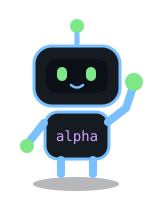

<div align="center">

# Oi, eu sou o Alberto 👋

**Dev em Belém/PA 🌴 · Professor de cursos técnicos · Eterno aprendiz**

Gosto de entender como as coisas funcionam. Às vezes, isso vira código.

<p>
  
  
</p>

</div>

## Um pouco sobre mim

Sou professor de cursos técnicos em **Informática, Redes de Computadores e Ciência de Dados**. Também sou um eterno aprendiz, ainda no **doutorado em Computação Aplicada**, explorando visão computacional e IA. Entre uma aula e um experimento, sigo encontrando mais uma coisa para aprender. Gosto de automatizar tarefas, explorar IA e descobrir o que acontece por trás de uma ferramenta. Tenho uma queda por código aberto e por coisas que consigo rodar na minha própria máquina.

```python
alberto = {
    "base": "Belém, Pará",
    "interesses": ["automação", "IA", "redes", "dados"],
    "ensino": ["Informática", "Redes", "Ciência de Dados"],
    "aprendizado": "doutorado em andamento",
    "metodo": "entender, testar, ajustar, repetir",
    "status": "mais uma ideia em alpha",
}
```

## O que anda aberto no meu terminal 🧑‍💻

- 🐍 Python, APIs e scripts para facilitar a vida.
- 🧠 Visão computacional e experimentos com IA.
- 🐧 Linux, Docker e ferramentas que posso hospedar por conta própria.
- 🛠️ Ideias de ferramentas para aprender e ensinar programação.

Por aqui, os projetos ainda estão em **alpha**. Este GitHub é meu laboratório: tem rascunho, experimento e coisa que ainda vai mudar bastante.

## Ferramentas que aparecem por aqui 🧰

<p align="center">
  
</p>

## Fora do código 🎸

Rock, começando no violão, astronomia e leituras de física, filosofia e tecnologia. A lista de interesses cresce mais rápido que o tempo disponível.

## Bora trocar uma ideia? 💬

Sobre código aberto, automação, IA, redes ou alguma ideia que também esteja em alpha.

- 🎓 **Acadêmico (UFPA):** [alberto.gama@itec.ufpa.br](mailto:alberto.gama@itec.ufpa.br)
- 🏫 **Institucional (SECTET):** [alberto.gama@docente.sectet.pa.gov.br](mailto:alberto.gama@docente.sectet.pa.gov.br)
- 📫 **Pessoal:** [albertomateus9@gmail.com](mailto:albertomateus9@gmail.com)
